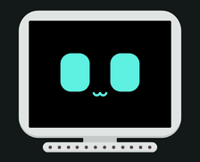
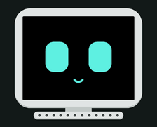
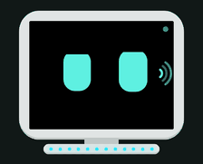
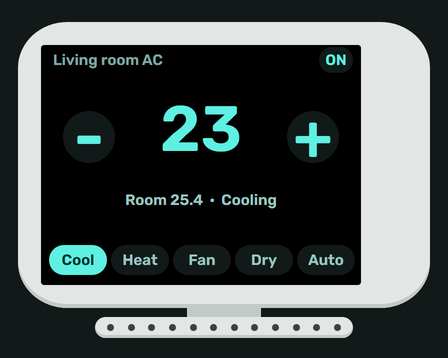

# Dravix

**A cute desk assistant for Home Assistant, on the M5Stack StackChan.**

Dravix is firmware for the StackChan robot. Say "Okay Nabu" and it talks with you through
Home Assistant Assist. It reacts when you pet it, shake it or walk up to the desk, plays games
with you, and keeps your Home Assistant controls one swipe away from its face. It all runs on
the robot and in your own Home Assistant: no add-on, no server, no cloud account.

<p align="center">
  
</p>

## What it does

- **Talks with Home Assistant Assist.** Say "Okay Nabu": a chime, then it listens, thinks and
  answers, with a face for every step. Timers ring on the robot; any touch stops them.
- **Has feelings.** 22 animated expressions with little gloved hands. Pet its head and it melts,
  hug it (two pads at once) and it falls in love, shake it and it gets dizzy (grumpy the third
  time), pick it up and it's surprised, walk up to the desk and it waves hello. At night it gets
  sleepy, and in a dark room it goes to sleep.
- **Your controls, one swipe away.** Swipe left from the face: **Screen 1** and **Screen 2**
  (4 tiles each: lights, switches, fans, scenes, scripts, buttons), the **air conditioner**
  (temperature, Cool / Heat / Fan / Dry / Auto, on and off) and **Games**. You choose every tile
  in Home Assistant.
- **Plays.** Rock paper scissors, Bang!, a reaction game, coin, dice and a magic 8-ball, plus
  camera games: Chameleon, Photo booth, Mirror, Desk guard and Follow me.
- **Private by design.** A small green dot in the top-right corner whenever the microphone or
  the camera is on. "Microphone mute" turns listening off completely.
- **Lights up.** The LED bar under the face shows what it feels, and stays dark at rest.
- **Three modes.** Normal: it looks around now and then, and perks up when it hears its name.
  Busy: everything as usual, but the head stays still. Sleep: just a clock, the date and the battery.
- **Private mode.** No camera and no microphone at all, whatever asks for them.

## Faces

Rounded aqua eyes on black, a thin mouth when it needs one, and little gloved hands that pop up for
a wave, a thumbs-up or a cheer. The LED bar under the face joins in. Here are six of them:

<table>
<tr>
<td align="center" width="33%"><br><b>Happy</b><br><sub>good news, a compliment</sub></td>
<td align="center" width="33%"><br><b>Love</b><br><sub>a long pet, or a hug</sub></td>
<td align="center" width="33%"><br><b>Hello</b><br><sub>you came back to the desk</sub></td>
</tr>
<tr>
<td align="center" width="33%"><br><b>Listening</b><br><sub>you talk; the green dot is on</sub></td>
<td align="center" width="33%"><br><b>Thinking</b><br><sub>Assist is on it</sub></td>
<td align="center" width="33%"><br><b>Done!</b><br><sub>a timer set, a tile tapped</sub></td>
</tr>
</table>

**…and 16 more it keeps to itself.** Pet it, shake it, pick it up, leave it alone, keep it up late, point a finger at it: it has a face for that, and a few secret ones too. Find them on your robot.

<sub>Pictures rendered from the Face Lab, where the faces were designed; the robot draws the same poses.</sub>

## Screens

<p align="center">
  
  
  
</p>
<p align="center"><sub>Screen 1 · the air conditioner · Games, rendered from the firmware's layout (the tile names are examples)</sub></p>

Swipe left from the face: Screen 1 → Screen 2 → Air conditioner → Games → back to the face
(swipe right to go the other way). After 30 seconds without a touch it comes back to its face.

**Swipe down** on the face for a thin bar with the time, the date and the battery; **swipe up**
to hide it. **Hold the face** for a moment to open the mode menu.

## Install

You need:

- an **M5Stack StackChan** (the CoreS3 kit),
- **Home Assistant** with the **ESPHome** add-on (ESPHome 2026.8 or newer),
- an **Assist** voice assistant (Settings → Voice assistants).

1. **Add your Wi-Fi to ESPHome.** ESPHome → **Secrets** (top right):
   ```yaml
   wifi_ssid: "YourWifi"
   wifi_password: "your-password"
   ```
2. **Create the robot.** ESPHome → **+ New device** → name it `stackchan` → skip the rest.
   Click **Edit**, replace everything with [`deploy/esphome/stackchan.yaml`](deploy/esphome/stackchan.yaml),
   and **Save**.
3. **Install.** The first time, connect the robot to your computer with USB-C and choose
   **Install → Plug into this computer** (or **Manual download** and flash it at
   [web.esphome.io](https://web.esphome.io)). After that, Install works over Wi-Fi.
4. **Add it to Home Assistant.** Settings → Devices & services: the robot shows up as discovered,
   click **Configure**. Then open **ESPHome** → the robot → **Configure** and turn on
   **Allow the device to perform Home Assistant actions** (the tiles, the air conditioner and
   the photo events need it).
5. **Pick its voice.** On the robot's device page, choose the **Assistant** it should use.

**Updating:** press **Install** in ESPHome. The device file pulls the newest firmware from this
repo on every build.

### Choose what's on the screens

Open the robot's device page in Home Assistant (Settings → Devices → the robot). Under
**Configuration** you'll find **Tile 1** to **Tile 8** and **Air conditioner**. Type an entity id
in each one, for example `light.desk_lamp`, `switch.coffee_machine`, `scene.movie_time` or
`climate.living_room`. Tiles 1–4 are Screen 1, tiles 5–8 are Screen 2. About 20 seconds after a
change the robot restarts by itself, to follow the new entities.

A tap toggles lights, switches, fans and input booleans, and runs scenes, scripts and buttons.

## Things to try

| You | It |
|---|---|
| Say "Okay Nabu", then ask something | Listens (green dot), thinks, answers |
| Ask for a timer | Sets it; when it rings, touch its head to stop it |
| Touch the pads on its head | Enjoys it; keep going for 3 seconds and it falls in love |
| Touch two pads at once (a hug) | Love |
| Shake it | Dizzy; the third time in 30 seconds, grumpy |
| Pick it up | Surprised |
| Come back to the desk after 5 minutes away | Waves hello |
| Leave it alone | Bored after a while, then a still, dimmed screensaver |
| Turn off the lights at night | Falls asleep (a clock), wakes up in the morning |
| Hold its face for a moment | The mode menu: Normal, Busy, Sleep, Private mode |
| Swipe down on its face | The time, the date and the battery (swipe up to hide) |

## Games

Swipe to **Games** (right from the face, or left from the air conditioner) and tap one.

| Game | How to play |
|---|---|
| Rock paper scissors | First to 2 wins. When it says "Shoot!", tap rock, paper or scissors on the screen, or a pad on its head. |
| Bang! | Point a finger right at it from close up: it puts its hands up. Then shout "BOOM!" (or tap its head). |
| Reaction | Wait for "Now!", then tap as fast as you can. It remembers your best time. |
| Coin, Dice | Tap to flip or roll. |
| Magic 8-ball | Think of a yes-or-no question, then tap. |
| Chameleon | Hold something colourful in front of it: its eyes take that colour for a minute. |
| Photo | 3, 2, 1, flash: the photo shows on its screen. Tap it to take another. |
| Mirror | Shows what its camera sees for 20 seconds. Tap to take a photo. |
| Desk guard | Arms itself after 10 seconds. If someone comes close: "Who are you?!" and a photo. Touch its head to turn it off. |
| Follow me | Its eyes follow movement in front of it. The green dot stays on while it runs. |

**Say it:** "Okay Nabu, let's play rock paper scissors", "Okay Nabu, flip a coin", "Okay Nabu,
busy mode"… in English or in Hebrew. Paste [`docs/ha-voice.yaml`](docs/ha-voice.yaml) into
Home Assistant once (an automation), and it knows every game and mode.

**Photos in Home Assistant (optional):** the robot only shows photos on its screen. To save them
and get them on your phone, add the automation in
[`docs/ha-automations.yaml`](docs/ha-automations.yaml).

## Modes and private mode

| Mode | |
|---|---|
| **Normal** | Everything. Now and then it glances to one side, and it perks up when it hears "Okay Nabu" |
| **Busy** | Everything as usual, but the head doesn't move at all |
| **Sleep** | A dim clock with the date and the battery. It doesn't react to touch, shaking or people. "Okay Nabu" still works, and a timer still rings |

Switch modes from the menu (hold the face), from Home Assistant (**Mode**), or by voice. At night
in a dark room it falls asleep by itself and wakes up in the morning.

**Private mode** works with any mode: the microphone stops and only ever hears silence, and the
robot restarts so the camera isn't even started. No wake word, no camera games; a small
microphone-off and camera-off icon shows where the green dot would be. Turn it on from the menu,
from Home Assistant (**Private mode**) or by voice ("Okay Nabu, private mode"). It turns off
from the menu or from Home Assistant, and the robot restarts again.

## In Home Assistant

The robot is an ordinary ESPHome device. Its page has:

| Controls | |
|---|---|
| **Face** | Show any expression now |
| **Screen** | Jump to the face, Screen 1, Screen 2, the air conditioner or Games |
| **Microphone mute**, **Wake sound** | Listening off; the chime before it listens |
| **Mode** | Normal, Busy (the head stays still) or Sleep (a clock) |
| **Private mode** | No camera and no microphone (the robot restarts) |
| **Follow me**, **Desk guard** | The two camera games that run in the background |

| Configuration | |
|---|---|
| **Tile 1 … 8**, **Air conditioner** | What the screens control |
| **Screen brightness**, **LED brightness**, **Reaction LEDs** | Light |
| **Sleep when the room is dark** | Falls asleep by itself at night |
| **Screensaver after**, **Bored after** (minutes), **Night from**, **Night until** (hours) | Timing |
| **Bang loudness** | How loud "BOOM!" has to be |

Sensors: **State**, **Last heard**, **Last reply**, **Last voice problem**, **Firmware**,
**ESPHome version**, **Touchscreen**, **Loop time**, **WiFi signal**, **Ambient light**, **Battery**,
**Charging**.

Automations can make it react. Replace `stackchan` with your robot's name:

```yaml
action: esphome.stackchan_show_face
data:
  face: happy          # happy, sad, love, done, greet, surprised, angry, doubt, dizzy, error
```

```yaml
action: esphome.stackchan_play_game
data:
  game: rps            # coin, dice, 8ball, reaction, bang, chameleon, photo, mirror, guard, follow, games
```

```yaml
action: esphome.stackchan_set_mode
data:
  mode: busy           # normal, busy, sleep
```

```yaml
action: esphome.stackchan_private_mode
data:
  enabled: true
```

## Good to know

- **Status:** Dravix 2.0 is brand new (November 2026). Every change to `main` is compiled on
  ESPHome 2026.8.2 and on the latest release; its first tests on a real robot are under way.
- **"Done!"** shows when a timer is set, when Home Assistant confirms a tile tap, or when an
  automation asks for it: Assist doesn't tell the robot whether it did something or only answered.
- **The camera games run on the robot.** They look at colour and movement, not at faces or hands.
  Bang! notices a pointing finger with the distance sensor.
- **Head moves never overlap sound**, so the robot keeps still while you talk to it.
- **Private mode is software, done thoroughly:** the microphone is stopped and muted (it would only
  hear silence), and after the restart the camera is never started. Home Assistant can turn it off.

## Coming from the old dravix-os add-on?

1. Home Assistant → Settings → Add-ons → **Dravix** → **Stop**, then **Uninstall**. In the
   add-on store (⋮ → Repositories) remove the dravix-os repository.
2. Keep your robot's file in ESPHome as it is (it already points at this repo) and press
   **Install**.

The old project is kept on the [`v1` branch](https://github.com/YossiKon/dravix-os/tree/v1).

## How it's made

The firmware modules, the face state machine and the vendored parts are described in
[docs/firmware.md](docs/firmware.md).

## Credits

- [M5Stack](https://github.com/m5stack/esphome-yaml) for the StackChan and its ESPHome board
  support (MIT), vendored in `deploy/esphome/v2/hardware.yaml`.
- [ESPHome](https://esphome.io) and [Home Assistant](https://www.home-assistant.io).
- [Rubik](https://fonts.google.com/specimen/Rubik) (SIL Open Font License) and
  [Material Design Icons](https://pictogrammers.com/library/mdi/).
- The wake chime comes from [Home Assistant Voice PE](https://github.com/esphome/home-assistant-voice-pe).

## License

[MIT](LICENSE)
